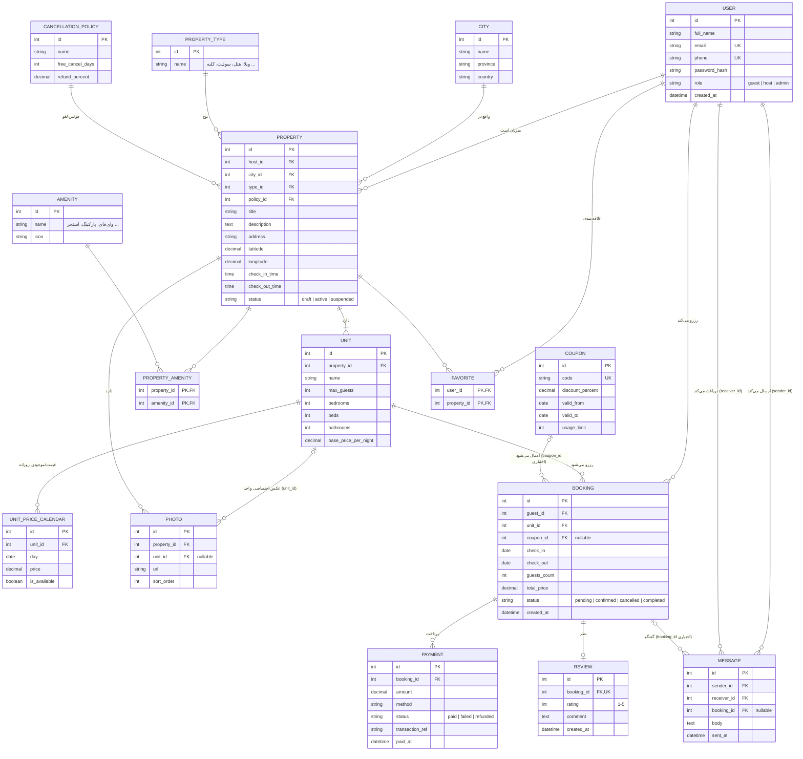

# ERD سایت رزرو اقامتگاه

## نکات طراحی
- **PROPERTY در برابر UNIT**: اقامتگاه (مثلاً هتل) می‌تواند چند واحد/اتاق داشته باشد؛ رزرو روی UNIT انجام می‌شود.
- **UNIT_PRICE_CALENDAR**: قیمت و موجودی هر روز جدا نگهداری می‌شود (تعطیلات، فصل پرتردد، مسدودسازی).
- روی `UNIT_PRICE_CALENDAR` ترکیب `unit_id + day` باید یکتا باشد تا یک واحد برای یک روز دو قیمت نداشته باشد.
- **PROPERTY_AMENITY / FAVORITE**: جداول واسط برای رابطه چند‌به‌چند.
- **REVIEW** با `booking_id` یکتا: فقط مهمانی که واقعاً اقامت داشته می‌تواند یک نظر ثبت کند.
- جلوگیری از رزرو هم‌پوشان باید در لایه برنامه/دیتابیس (constraint یا تراکنش) روی `unit_id + بازه تاریخ` اعمال شود.
